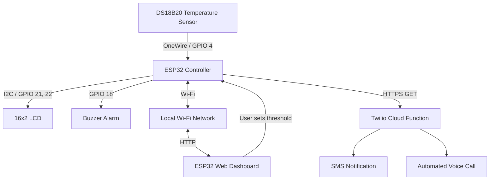

# ESP32 Smart Wireless Temperature Monitoring with SMS and Voice-Call Notifications

An ESP32-based IoT temperature monitoring prototype that reads a DS18B20 sensor, displays live readings on a 16×2 I2C LCD and browser dashboard, and triggers a local buzzer plus remote SMS/automated voice-call notifications when a configurable temperature threshold is exceeded.

> **Project status:** Hardware prototype and firmware documentation. Validate the complete setup on your own hardware and Twilio account before relying on it for safety-critical monitoring.

## Features

- DS18B20 digital temperature measurement using the OneWire interface.
- 16×2 I2C LCD for local temperature and threshold/status display.
- ESP32-hosted HTTP dashboard on the local Wi-Fi network.
- Browser-based threshold configuration.
- Buzzer alarm when measured temperature exceeds the configured threshold.
- HTTPS request from ESP32 to a Twilio-hosted Function; the cloud function is responsible for sending SMS and placing the automated voice call.
- Serial output for connection details and debugging.

## System block diagram

**Important:** The ESP32 does not directly originate a cellular call. It makes an HTTPS request to the configured Twilio Function. The cloud-side function uses Twilio services to send the SMS and initiate the voice call.

## Hardware

| Component | Purpose |
|---|---|
| ESP32 development board | Sensor acquisition, Wi-Fi, web server and alert control |
| Waterproof DS18B20 | Digital temperature sensing |
| 16×2 LCD with I2C backpack | Local status display |
| Active buzzer | Audible high-temperature alert |
| 1 kΩ pull-up resistor (working prototype value) | Pull-up on the DS18B20 data line |
| Breadboard and jumper wires | Prototyping connections |

A **4.7 kΩ** pull-up is the conventional DS18B20 data-line value and is a suitable alternative to test. The prototype debugging history found that a 47 Ω resistor did not work; replacing it with 1 kΩ allowed the sensor to be detected.

See [wiring and connections](hardware/wiring-and-connections.md) and [component notes](hardware/components.md).

## Pin configuration

| Signal | ESP32 pin |
|---|---:|
| DS18B20 data | GPIO 4 |
| Buzzer signal | GPIO 18 |
| LCD SDA | GPIO 21 |
| LCD SCL | GPIO 22 |

See [pin-configuration.csv](hardware/pin-configuration.csv) for the full connection table.

## Software and libraries

- Arduino IDE (or compatible Arduino build environment)
- ESP32 board support package
- OneWire
- DallasTemperature
- LiquidCrystal_I2C
- ESP32 core libraries: WiFi, WebServer, HTTPClient, WiFiClientSecure and Wire

Install the ESP32 board package through Boards Manager and the external libraries through Library Manager. Exact library forks can differ; use versions compatible with your installed ESP32 core.

## Setup

1. Assemble the circuit using the wiring guide.
2. Install the required ESP32 board package and libraries.
3. Open `src/temperature_monitor.ino`.
4. Replace `YOUR_WIFI_NAME` and `YOUR_WIFI_PASSWORD` with the credentials of the Wi-Fi network/hotspot used by both the ESP32 and the laptop/phone.
5. Configure the Twilio Function endpoint in the sketch. Keep any authentication secret out of source control.
6. Select the correct ESP32 board and serial port, then upload.
7. Open Serial Monitor at **115200 baud** and note the IP address printed after Wi-Fi connection.
8. Open that IP address in a browser on the same local network.
9. Set a threshold and test the alarm/notification path using a controlled temperature test.

The firmware uses Wi-Fi station/client mode: it joins an existing access point. It does not create its own ESP32 access point.

## Repository map

- `src/` — Arduino firmware
- `hardware/` — component list, wiring and pin mapping
- `docs/` — architecture, algorithm, design decisions, test plan, cloud setup and contribution disclosure
- `media/` — location for project photographs, screenshots and diagrams

## Security and reliability notes

- Never commit Wi-Fi passwords, Twilio Account SID/Auth Token, private phone numbers, or endpoint authentication secrets.
- A previously exposed Twilio Auth Token should be regenerated in the Twilio Console. Do not reuse a credential that has appeared in a screenshot or public repository.
- Protect the Twilio Function with request authentication/shared-secret validation and rate limiting before making it publicly reachable. An unauthenticated endpoint can be abused to trigger messages or calls.
- The sketch currently uses `WiFiClientSecure::setInsecure()` for prototype connectivity. This disables TLS certificate verification and is **not appropriate for production**. Configure certificate validation before deployment.
- This is a prototype, not a certified safety alarm. Add sensor-fault handling, alert cooldown/retry policy, power-failure handling and independent fail-safe measures for real deployments.

## Documentation

- [System architecture](docs/system-architecture.md)
- [Algorithm](docs/algorithm.md)
- [Design decisions](docs/design-decisions.md)
- [Testing and validation](docs/testing-and-validation.md)
- [Twilio setup and security](docs/twilio-setup.md)
- [Contributions and AI disclosure](docs/contribution-and-ai-disclosure.md)

## Contribution and AI disclosure

The project owner carried out the project selection, physical component assembly, wiring, hardware debugging and prototype observations. AI assistance was used for firmware structuring/refinement, web dashboard implementation guidance, cloud integration guidance and documentation drafting. The disclosure is detailed in [docs/contribution-and-ai-disclosure.md](docs/contribution-and-ai-disclosure.md).

## License

No license file is included at this stage. Unless a license is added by the repository owner, normal copyright restrictions apply and reuse is not automatically permitted.
