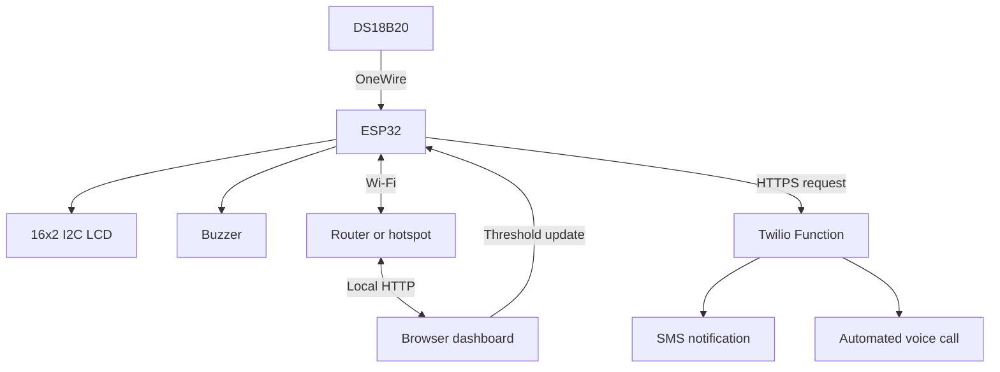

# System Architecture

## Functional blocks
1. **Sensing:** DS18B20 measures temperature over OneWire on GPIO 4.
2. **Controller:** ESP32 samples the sensor, compares readings with the active threshold and coordinates outputs.
3. **Local indication:** 16x2 I2C LCD displays readings/status; buzzer activates above threshold.
4. **User interface:** ESP32 hosts an HTTP dashboard. A browser on the same Wi-Fi network reads the dashboard and submits a threshold.
5. **Remote notification:** ESP32 sends an HTTPS GET request to a Twilio Function. The cloud Function triggers SMS and an automated voice call through Twilio services.

## Block diagram

The ESP32 detects the event and requests the cloud workflow. It is not a cellular modem and does not directly place the telephone call.
